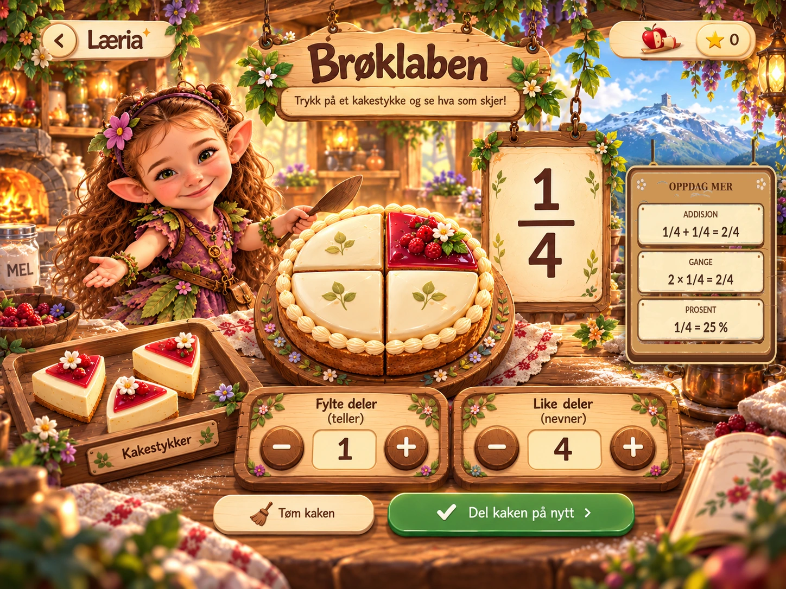

# LÆRIA – BRØKLAB FJORDBAKERI: LÅST ILLUSTRASJON OG OPPDAG MER

**Beslutning:** 24. oktober 2026. Brukeren har valgt å låse den opprinnelige illustrasjonen `brøklaben_i_fjordbakeriet.png`, og ønsker tydelig synlige, faglig korrekte addisjons- og gangestykker **i tillegg til prosent**.

## Ufravikelig referanse

- **Godkjent grunnillustrasjon:** `brøklaben_i_fjordbakeriet.png`, SHA-256 `90147295881a6f50987233dd3d2e53f955b18b5046656aff0cd38fcebf674623`.
- **Oppdatert, låst versjon:** `Broklab_Fjordbakeriet_Addisjon_Gange_Prosent_2026-10-24.png`, arkivert i Læria-biblioteket under `/Læria/Brøklab/Låste design/`; SHA-256 `fd645659dba6bed0a64a8a2cc37c37449745716d5946634db293b16e0d4e4b37`.
- Repoets illustrasjonskopi er høyoppløselig WebP, SHA-256 `20690f7b20837e8ea7a6e3c44b9a8c1f09985228d091ce98d44af55789647d10`.
- **Ikke erstatt denne komposisjonen** med et annet nygenerert bilde. Den senere alternative illustrasjonen med tre troll samtidig er *ikke* den låste fasiten.
- Skåla med karakteristisk tårn, verkstedet, kaken, storesøsters **originale låste ansikt/hår/klær**, varmt lys og tekstur, løse kakebiter, to nummerpaneler og knapper beholdes visuelt. Ett troll er aktivt om gangen. Lillesøster og lillebror byttes inn med sine godkjente originaler uten å endre komposisjonen.

## Nytt synlig illustrasjonselement: «Oppdag mer»

Integrert hengende treskilt med tre tydelige deler:

1. **Addisjon:** `1/4 + 1/4 = 2/4`. Barnet oppdager at en ekstra fjerdedel gir to fjerdedeler.
2. **Gange:** `2 × 1/4 = 2/4`. To like fjerdedeler gir det samme som å legge dem sammen.
3. **Prosent:** `1/4 = 25 %`. Barnet ser den samme *aktuelle* kaken som prosent.

Dette er eksempler for startsituasjonen der kaken er delt i fire og én del er fylt. De skal **ikke være hardkodede etiketter** i en faktisk interaktiv app.

## Pedagogisk logikk ved implementering

- Begynn med én stor, fysisk/trykkbar kake og én fjerdedel fylt. De tre eksemplene er frivillige oppdagelser, ikke undervisningstvang.
- Addisjon og gange viser **samme visuelle mengde**, og regnestykkene endres når barnet deler opp kaken på nytt.
- Ved `n/d` og `n<d` kan den frivillige «legg én bit til»-oppdagelsen være `n/d + 1/d = (n+1)/d`; vis parallelt `(n+1) × 1/d = (n+1)/d` som gjentatt enhetsbrøk.
- Ved full kake (`n=d`) vises ikke oppfordring om å legge inn en ikke-eksisterende ekstra sektor.
- Prosent følger **aktuell** `n/d`: `100n/d %`; bruk et tydelig omtrentlig-tegn ved avrunding (f.eks. `1/3 ≈ 33,3 %`), ikke feilaktig eksakt likhet.
- Velger barnet addisjons- eller gangeeksempelet, skal det illustreres gjennom den ekte kaken og de ekte bitene, ikke bare vises som tekst ved siden av.
- Bruk én sammenhengende eventyrlig spillverden. Skåla, tremateriale, rekvisitter, hjelperfiguren og kontroller bygges av selvstendige illustrerte lag og interaktive objekter. Illustrasjonsbildet er **designfasit**, ikke klikkbar helskjermbakgrunn.
- Kake, brøktall og begge `+/-`-kontroller må være synlige uten scrolling på vanlig iPhone. «Oppdag mer» kan være kompakt/sammenfoldbar på mobil, og på iPad tydelig plassert ved siden av kakens brøktavle.
- Bevar alle de sju eksisterende Brøklab-aktivitetene, lagret fremgang og øvrige matematiske modeller.

## Status / sikkerhetsport

Dette er en **låst visuell produktbeslutning**, ikke en melding om at appen er ferdig. PR #211 er fortsatt et utkast. Den tidligere programmatisk utformede scenen er avvist som visuell løsning; referansen her erstatter ikke test og faktisk brukeraksept. Ingen merge eller publisering før korrekt, spillbar implementasjon og faktisk iPhone/iPad-Safari-kontroll.
