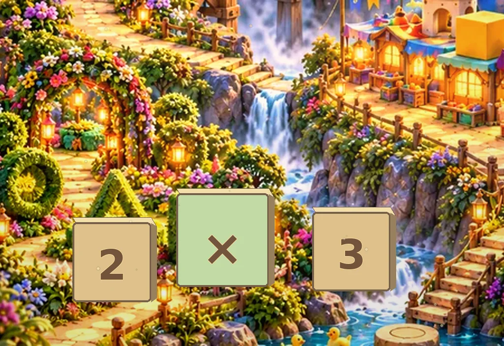
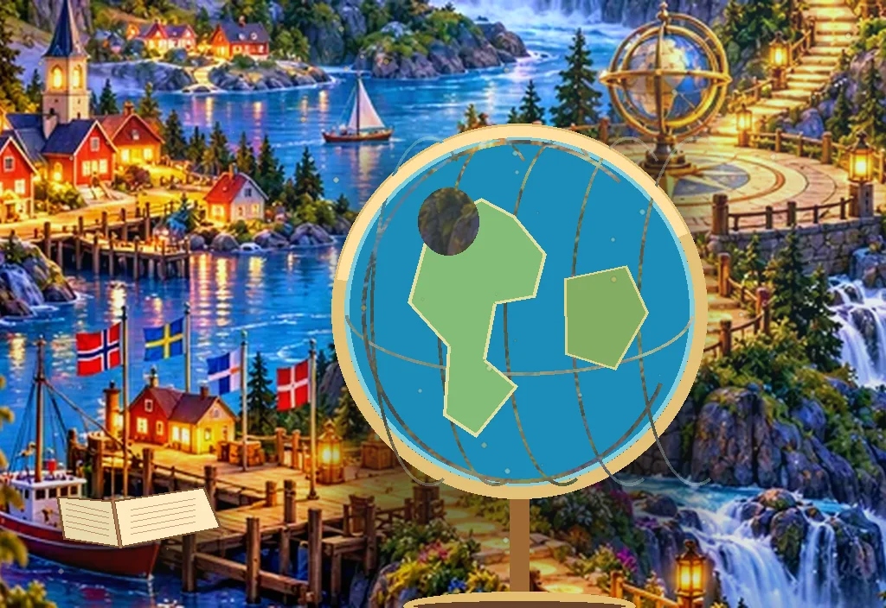
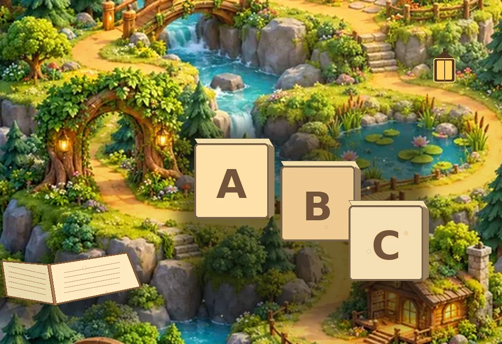
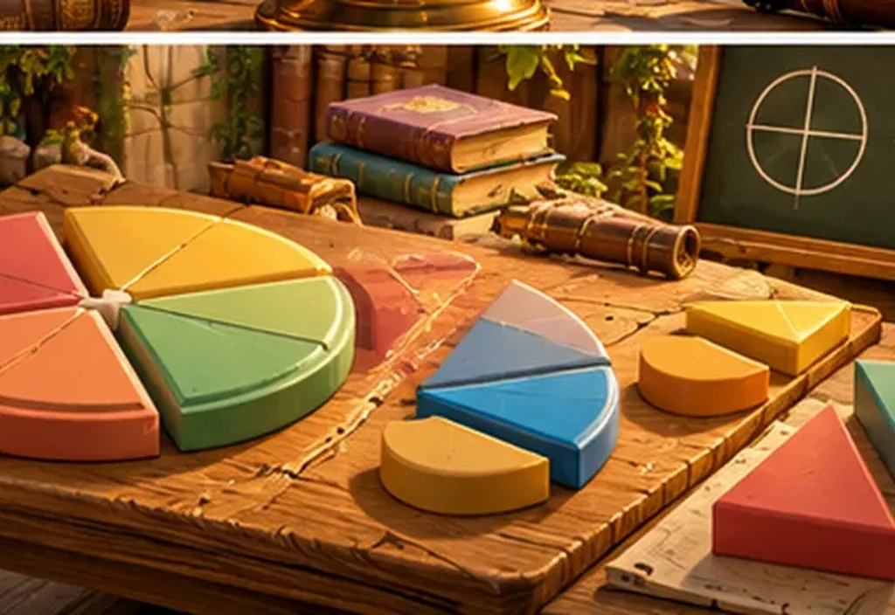
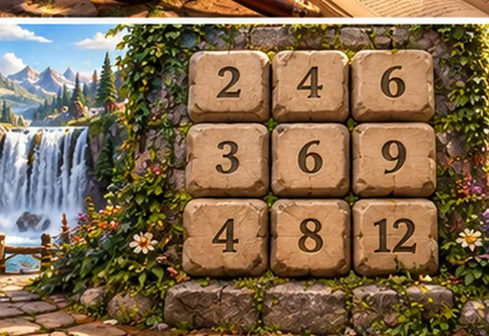

# Læria: låste premiumkort til Reisen og Utforsk

**Visuell referanse:** første godkjente premiumillustrasjon i prosjektchatten, 11. oktober 2026.

De åtte bildene er **selvstendige, maleriske kortscener**. De kommer fra en separat illustrasjonsplate med åtte scener, ikke fra skjermmockuper med knapper, tekster eller telefonrammer. Motivene er tilpasset kortenes bildeområde og levert som WebP (1024 × 704 px).

**Reisen:** Bokskogen, Tallenga, Ordlandsbyen, Nordlysleiren.

| Norsk: Bokskogen | Matte: Tallenga |
|---|---|
|  |  |
| **Engelsk: Ordlandsbyen** | **Geografi: Nordlysleiren** |
|  |  |

**Utforsk:** Kloden, Ordjakt, Brøklab, Gangetabell.

| Kloden | Ordjakt |
|---|---|
|  |  |
| **Brøklab** | **Gangetabell** |
|  |  |

`manifest.json` er sjekksummen for alle åtte illustrasjoner. `tests/laria-premium-art-integrity.cjs` kontrollerer byteverdier, dimensjoner, riktige filer og unikhet i GitHub Actions. Samlet kortbildepayload er under 750 KB. HTML-tekst, progresjon og knapper ligger fortsatt utenfor bildeflatene og eies av appen.

**Viktig:** Dette er kun illustrasjoner for **oversiktskortene**. De fire tidligere godkjente originale reisekartene i `laer-litt-mer/locked-journeys/` er ikke endret og skal aldri regenereres eller erstattes av disse filene. Tidligere prosedyre som overtegnet det samme Hjem-bildet åtte ganger, er fjernet for å unngå utilsiktet nedgradering.
